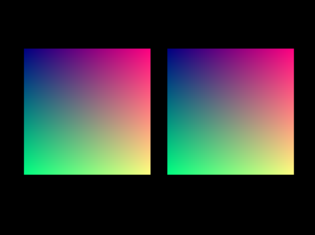
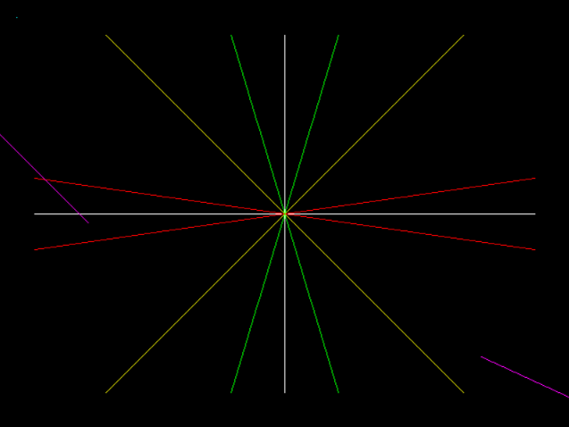
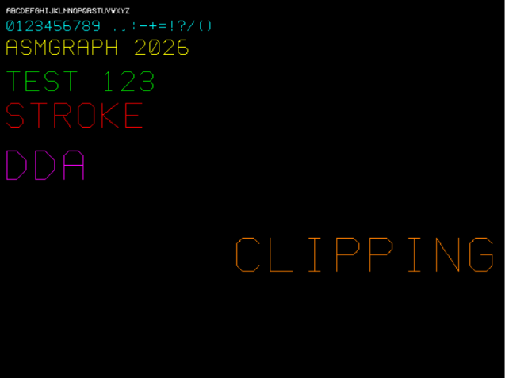

# AsmGraph

Libreria di **computer graphics scritta in Assembly x86 (MASM32)** per Windows, costruita seguendo, capitolo dopo capitolo, un testo classico sull'argomento.

> *English version: coming soon.*

## Obiettivo

Seguire il testo di riferimento (vedi [Riferimenti](#riferimenti)) per realizzare una libreria grafica completa partendo dalle basi: un frame buffer, i pixel, la generazione di linee, e poi gli argomenti dei capitoli successivi. Gli algoritmi del libro sono scritti in pseudocodice; qui vengono tradotti in assembly, un pezzo alla volta e provando ogni passo prima di passare al successivo.

Il frame buffer è indipendente dalle API di Windows: la GDI serve soltanto a mostrare il risultato nella finestra, così in futuro lo strato di visualizzazione si potrà sostituire (per esempio con OpenGL o DirectX) senza toccare gli algoritmi.

## Stato del progetto

Fase iniziale, ma già funzionante: finestra Win32, frame buffer a 32 bit, pixel e linee.





## Provalo subito

Nella cartella [`bin`](bin) trovi due programmi di prova già compilati:

| Programma | Cosa mostra |
|---|---|
| `bin/test_1_pixel.exe` | Due gradienti 256x256 identici: il primo disegnato con `PutPixel`, il secondo copiato leggendo il primo con `ReadPixel`. Se sono uguali, scrittura e lettura sono corrette. |
| `bin/test_2_lines.exe` | Una raggiera di linee dal centro in tutte le direzioni (orizzontali, verticali, diagonali, inclinazioni intermedie), un punto singolo e due linee che escono dal buffer. |
| `bin/test_3_stroke.exe` |  Una serie di stringhe di varie dimensioni disegnate con dei tratti usando `DrawLineDDA` per ogni tratto | `TestStroke ` |

> Gli eseguibili non sono firmati digitalmente: Windows SmartScreen o l'antivirus potrebbero mostrare un avviso, come accade per molti programmi di piccoli sviluppatori. Se preferisci non eseguirli, compila tu stesso i sorgenti: in [`bin/README.md`](bin/README.md) trovi come riprodurre ciascun programma di prova.

## Funzioni disponibili

| Funzione | File | Descrizione |
|---|---|---|
| `CreateFrameBuffer` / `DestroyFrameBuffer` | `src/FrameBuffer.asm` | Crea e libera il frame buffer (DIB section a 32 bit per pixel, top-down) |
| `ClearBuffer` | `src/FrameBuffer.asm` | Riempie tutto il buffer con un colore |
| `PutPixel` | `src/FrameBuffer.asm` | Accende un pixel, con controllo dei limiti |
| `ReadPixel` | `src/FrameBuffer.asm` | Legge il colore di un pixel |
| `DrawLineDDA` | `src/Lines.asm` | Disegna un segmento con l'algoritmo DDA, in virgola fissa 16.16 |
| `DrawCharStroke` | `src/Text.asm` | Disegna un carattere a segmenti |
| `DrawStringStroke` | `src/Text.asm` | Disegna una stringa usando DrawCharStroke per ogni carattere nella stringa |

- I colori sono DWORD nel formato `AARRGGBB`: il canale alfa (`AA`) non è usato e si lascia a 0, quindi `00FF0000h` è rosso.
- Al momento sono stati inseriti solamente i caratteri maiuscoli nella generazione dei font per i caratteri a tratto, quindi per creare o modificare i caratteri vedi [docs/StrokeFont.md](docs/StrokeFont.md).

## Requisiti

- Windows
- [MASM32 SDK](http://www.masm32.com/) installato in `c:\masm32`

## Compilazione

Dalla cartella del progetto, in un prompt dei comandi:

```bat
make.bat
```

Produce `AsmGraph.exe`. Il disegno di prova mostrato all'avvio si sceglie in `src/MainWndProc.asm`, come spiegato in [`bin/README.md`](bin/README.md).

## Struttura delle cartelle

```
AsmGraph/
├── AsmGraph.asm        punto d'ingresso, include tutti gli altri sorgenti
├── make.bat            compila il programma principale
├── bin/                eseguibili di prova già compilati e istruzioni per riprodurli
├── docs/               Documentazione del software 
│   └── img/            immagini per la documentazione
├── inc/                header comuni
│   ├── CommonHeader.inc    include delle API Windows
│   ├── CommonLib.inc       librerie da collegare
│   ├── Proto.inc           prototipi delle funzioni
│   ├── constants.inc       costanti e stringhe
│   ├── structs.inc         strutture dati
│   ├── globals.inc         variabili globali
│   └── StrokeFont.inc      tabella font caratteri

├── src/                sorgenti
│   ├── WinMain.asm                 inizializzazione e ciclo dei messaggi
│   ├── MainWndProc.asm             gestione dei messaggi della finestra
│   ├── RegisterWindowMainClass.asm registrazione della classe finestra
│   ├── FrameBuffer.asm             frame buffer, ClearBuffer, PutPixel, ReadPixel
│   ├── Lines.asm                   generazione di linee (DDA)
│   ├── Text.asm                    generazione di caratteri a tratti (tramite DDA)
│   └── TestDraw.asm                disegni di prova
└── res/                risorse (icone, menu, dialog)
```

Il progetto si assembla come **unità unica**: `AsmGraph.asm` include gli altri file con `include`.

## Metodo di sviluppo

Sviluppo **incrementale**: ogni funzione viene scritta e provata da sola prima di passare alla successiva, e ogni passo è un commit.

## Roadmap

- [x] Scheletro finestra Win32 con chiusura corretta
- [x] Frame buffer a dimensione fissa, `ClearBuffer`
- [x] `PutPixel` e `ReadPixel`
- [x] Generazione di linee con l'algoritmo DDA
- [x] Generazione di caratteri a tratti tramite l'algoritmo DDA
- [ ] Generazione di caratteri a matrice di punti
- [ ] Adattare la finestra alle dimensioni del buffer e gestire il ridimensionamento
- [ ] Proseguire con i capitoli successivi del libro
- [ ] Algoritmo di Bresenham (a conclusione del libro), con confronto con il DDA
- [ ] Documentazione in italiano e in inglese

## Riferimenti

- Steven Harrington, *Computer Graphics: corso di programmazione*, McGraw-Hill (edizione italiana; titolo originale *Computer Graphics: A Programming Approach*).

Questo repository non contiene testi, figure o scansioni del libro: il codice è un'implementazione originale degli algoritmi in esso descritti. Il progetto non è affiliato all'autore né all'editore.

## Licenza

Distribuito con licenza [EUPL v. 1.2](https://eupl.eu/1.2/it) (European Union Public Licence). Vedi il file [LICENSE](LICENSE).

Licensed under the EUPL
